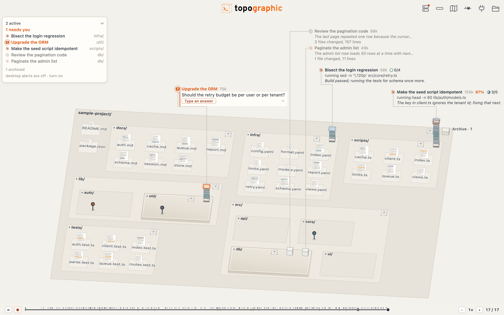

# Topographic | Agent IDE

A Mac app that shows your coding agents on a map of your project, so you can start them, watch them and talk to them in
one window. It drives the agents' own tools (Codex, Claude Code and others) with the accounts you are already signed in
to. A proof of concept.



## Install

1. Download **Topographic-arm64.dmg** from [Releases](https://github.com/rohanmahajan5/topographic/releases). Apple
   silicon Macs only.
2. Open it and drag **Topographic** into **Applications**.
3. The app isn't signed, so macOS blocks the first launch. Open **System Settings → Privacy & Security** and click
   **Open Anyway**.

The first launch downloads its own copy of Python (about 170 MB), then asks for a project folder. Sign in to Codex or
Claude Code from **Agents → Providers…**.

## Run from source

```sh
cd workspace
python3 server.py      # Python 3.11+; open http://127.0.0.1:4321
```

The Mac app: `cd app && npm ci && npm run build`. More in [`app/README.md`](app/README.md).
